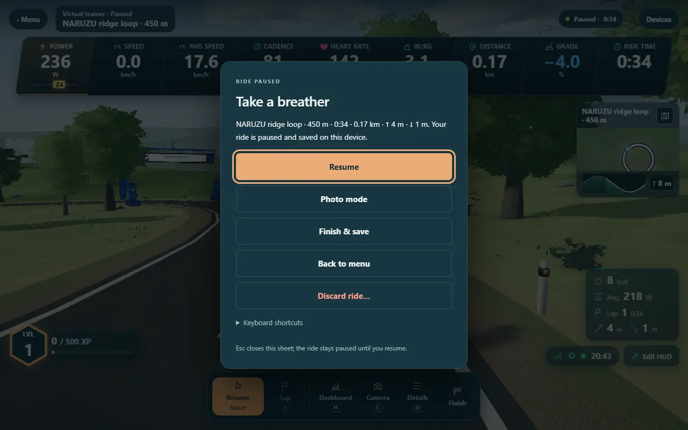
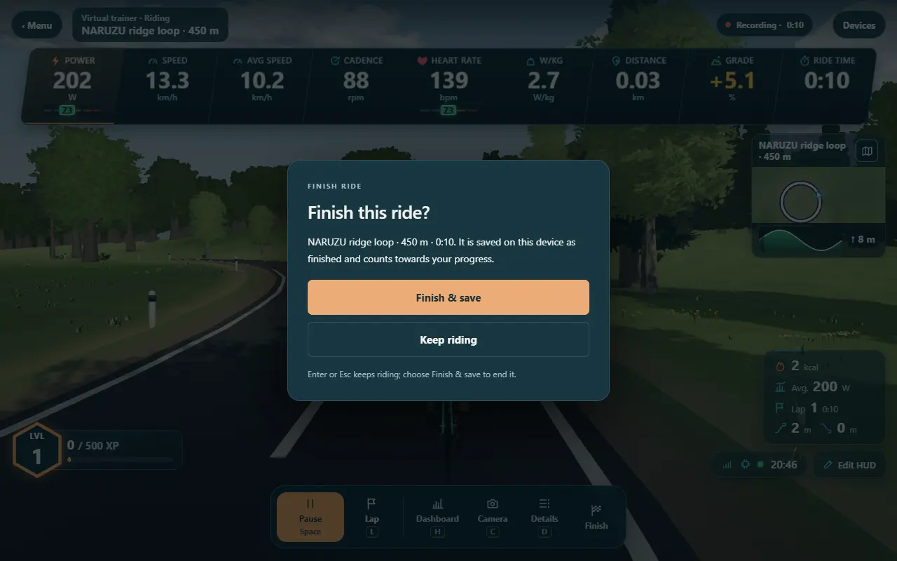
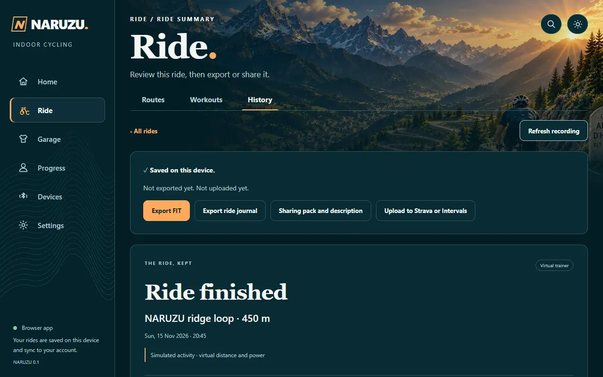

## Your ride is saved as you go

While you ride, the recording is saved on your device every second ("Saved on this device every second" in the status panel). If the app or the ride screen crashes, the ride reopens **paused** with everything recorded so far, ready to resume or finish. Home also offers **Recover unfinished ride**.

If saving fails (for example the device is out of storage), the ride pauses and tells you to export it now; the data is kept in memory until saving works again.

## Pause

Press **Space**, use the **Pause** button, or press **Esc**. **Esc** pauses and opens the pause sheet, titled "Take a breather". Its buttons:

- **Resume**
- **Photo mode**: look around the rider, zoom, blur the background and capture a photo.
- **Finish & save**
- **Back to menu**: leave the ride view; the ride keeps its saved state. A "Ride in progress" chip brings you back.
- **Discard ride...**
- **Keyboard shortcuts** (expandable).

Esc again closes the sheet; the ride stays paused until you resume. A ride also pauses by itself in some cases, and tells you why: when there is no power from the trainer for 15 seconds, when cadence stays too low (it resumes when you pedal), when the trainer stops or loses control, or when the app goes to the background.

## Finish

Choose **Finish** in the controls bar or **Finish & save**. A confirmation asks "Finish this ride?" and explains that it is saved on this device as finished and counts towards your progress. **Finish & save** ends it. **Keep riding** (or Enter, or Esc) carries on.

## Discard

**Discard ride...** (in the pause sheet and the Details drawer) asks "Discard this ride?". A discarded ride does not count towards your progress, but its recording stays in History in case you want to export it.

## The ride summary

After finishing you land on the ride summary, with "Saved on this device" and four actions:

- **Export FIT**
- **Export ride journal**
- **Sharing pack and description**
- **Upload to Strava or Intervals**

Below that you see distance, ride time, work in kJ, climbing, average power, heart rate, cadence and speed, moving and elapsed time, and normalized power (provisional with gaps or under five minutes). A workout ride adds a score and, for a ramp test, an estimated FTP. Rides done with the virtual trainer are labelled "Simulated activity".

Implausible readings (a sensor glitch rather than effort) are flagged for review instead of silently counted.

## Export a FIT file

**Export FIT** saves a FIT file that other platforms can import. It is the dependable hand-off: it works offline and needs no account.

- To put it in Garmin Connect, use that site's **Import Data** and choose the file. NARUZU identifies its own source in the file; it does not pretend to be another brand's device, so brand-specific badges cannot be promised.
- The **sharing pack** is a ZIP with a FIT file, ride photos and an activity description. Strava uploads include the description automatically; add photos in Strava or Garmin Connect after importing.
- **Export ride journal** saves the full journal as JSON, which keeps provenance (such as the original GPX).
- Open any saved ride later from **Ride, History** to export it again.

## Uploads to Strava and Intervals.icu

Uploads are optional and start only when you press Send. Linking Strava needs the Windows app and your own Strava application settings; Intervals.icu needs your athlete ID and API key. Each upload has a status and a queue, and the app avoids re-posting an upload whose outcome is uncertain. **Live provider uploads have not been verified**; keep a local FIT export as your backup.

## Ride history

**Ride, History** lists saved rides. Open one to see its summary, **Ride again**, or **Recover ride** if it was unfinished. Under Settings, Data and accounts you can delete rides older than a year to free space.

_Last verified against version 0.1.0-beta.1._
