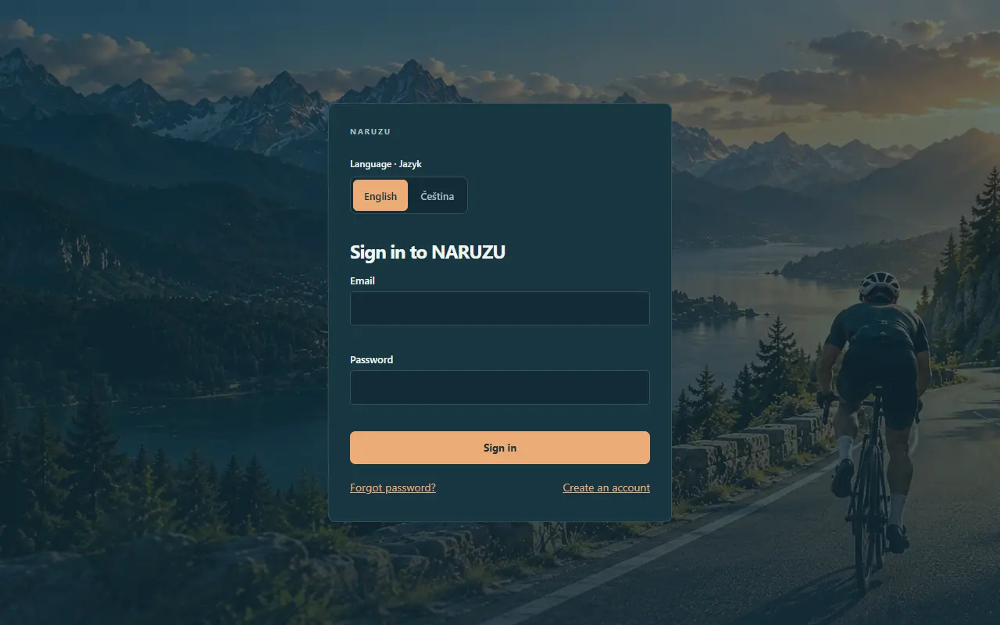
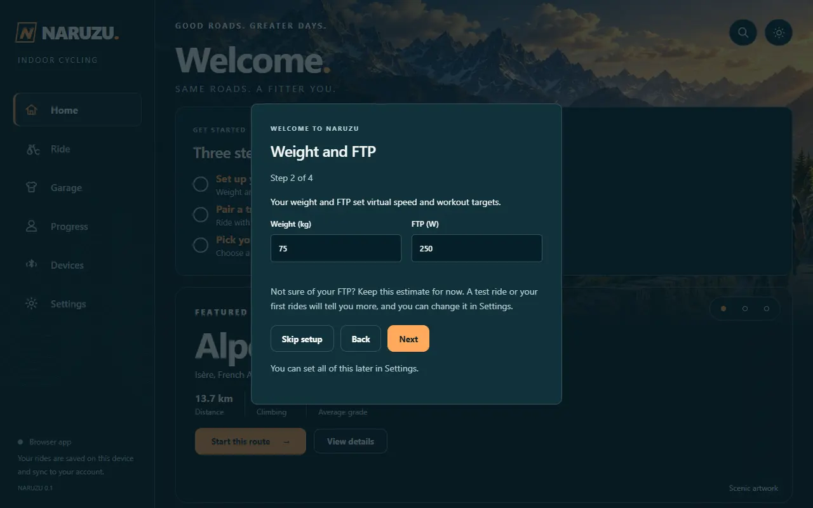

## Sign in

Sign-in is required unless the app was built for riders without an account server. The sign-in screen offers an email and password, **Forgot password?** and **Create an account**, and a language switch (English or Čeština).

Things to know about accounts (from the project's account notes):

- You must be 16 or older to create an account.
- Passwords are 10 to 128 characters; common passwords are refused.
- You can turn on two-factor sign-in (an authenticator app) in Settings. You get 10 single-use recovery codes.
- Your rides always stay on your device. A new account is private by default: it cannot be found by handle, rides are private and raw ride data is not shared.
- Riding works offline. Account changes need a connection. If a device is offline for more than 30 days you must sign in again; the data on the device is kept.

**Not yet verified for the public beta:** how and where public riders obtain an account, and which account server the public build talks to. The app looks for its server at a build-time address. Check the release notes that came with your copy.

## The first-run wizard

On a fresh profile a short wizard opens with four steps. You can **Skip setup** at any time and change everything later in Settings.

1. **Language and units.** Pick English or Czech. Units are **Metric** (kg, km) by default; **Imperial** (lb, mi) is available.
2. **Weight and FTP.** These set your virtual speed and workout targets. Weight must be 20 to 300 kg. If you do not know your FTP, keep the estimate for now; a test ride will tell you more. See [Ramp test and FTP](/naruzu-web/docs/user/ramp-test-and-ftp/).
3. **Your trainer.** Choose **Pair a trainer** (opens Devices, and setup continues when you return) or **Ride without a trainer**, in which case NARUZU simulates your effort.
4. **Your first ride.** Pick a road and start pedalling. Choose **Finish setup**.

The wizard is shown once per device. Its state is stored only on that device.

## Home

After the wizard, Home shows a "Three steps to your first ride" checklist: set up your rider, pair a trainer or use the virtual one, and pick your first ride. It also shows a featured route and, after your first ride, your last ride.

If you closed the app in the middle of a ride, Home offers **Recover unfinished ride**. Everything recorded so far is kept and the ride reopens paused.

## Navigation

The left menu has six places: **Home**, **Ride**, **Garage**, **Progress**, **Devices** and **Settings**. Ride has the tabs Routes, Workouts and History. A search button at the top finds screens and routes.

_Last verified against version 0.1.0-beta.1._
