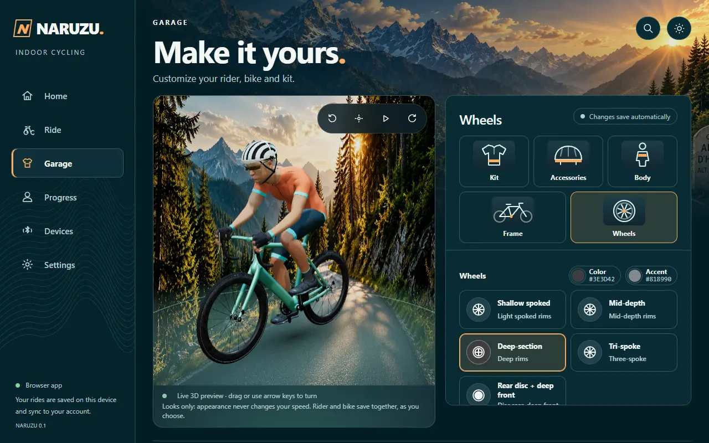
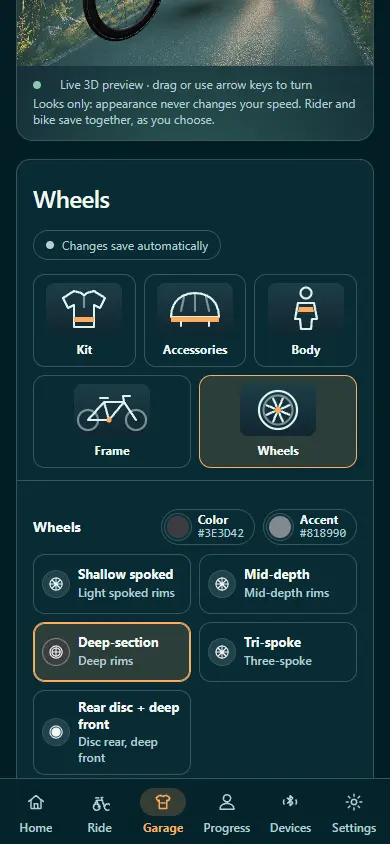

The **Garage** ("Make it yours") lets you customise how your rider and bike look. A live 3D preview sits on the left: drag it, or use the arrow keys, to turn it.

## Categories

Five categories sit on the right:

- **Kit**: jersey and shorts presets such as Race (fitted, short sleeve), Endurance, Aero, Thermal and Club, with colours.
- **Accessories**: helmet, glasses, gloves, socks, shoes and similar items.
- **Body**: the rider's body and hair.
- **Frame**: the bike frame, for example a light road frame, a relaxed road frame, a gravel frame, a time-trial frame or a race frame.
- **Wheels**: shallow spoked, mid-depth, deep-section, tri-spoke or a rear disc with a deep front, plus colour and accent.

Changes save automatically. Appearance is **cosmetic only**: it never changes your speed or power. Some frames and wheels have to match; if a wheelset does not fit the frame, the Garage switches it and tells you why.

## Back up your look

Under **Back up** you can **Export appearance** and **Restore appearance**, with **Undo restore** if you change your mind.

On a narrow window (390 pixels) the preview sits above the category choices.

## What is not in the public beta

The coin **Shop** and **Companions** are not part of the public beta, so this guide does not cover them. The level and XP badge on the ride screen is part of progress tracking, not of the Garage.

Garage previews use your graphics card. On weak graphics the preview can take a moment ("Loading your rider...").

_Last verified against version 0.1.0-beta.1._
