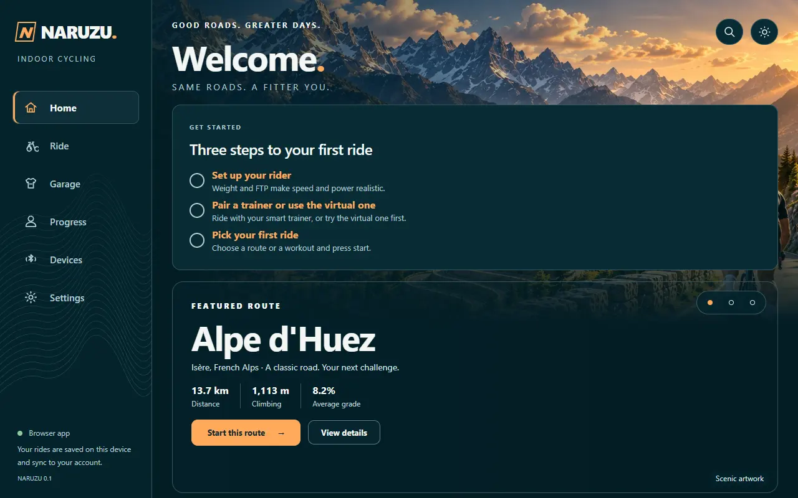

NARUZU is an indoor cycling app. You ride a road on your trainer (or without one, using a simulated rider), and the app builds scenery around the road, records the ride and lets you export it as a FIT file.

This guide covers the **public beta**. It tells you how to install the app, pair your trainer and sensors, start a ride, use the ride screen, and fix common problems. Where something has not been checked on real hardware, the page says **not yet verified** instead of promising it.

## What you can do

- Ride a demo loop, a scenic ride, a real-road **Quick Ride** loop, or your own GPX route. See [Routes and Quick Ride](/naruzu-web/docs/user/routes-and-quick-ride/).
- Follow a structured workout, with your trainer holding the target watts (**ERG**). See [Workouts and ERG](/naruzu-web/docs/user/workouts-and-erg/).
- Measure your FTP with a ramp test. See [Ramp test and FTP](/naruzu-web/docs/user/ramp-test-and-ftp/).
- Watch live power, speed, heart rate and more on the [ride screen](/naruzu-web/docs/user/ride-hud/).
- Dress your rider and bike in the [Garage](/naruzu-web/docs/user/garage/).
- Keep your rides on your own device and export them as FIT files. See [Pause, finish and export](/naruzu-web/docs/user/finish-and-export/).

## What is not in the public beta

- Career mode, stage races and real race events are switched off. Event names are generic.
- The coin Shop and the Companions (other riders and ghosts you can ride with) are **not in the public beta** and are not described in this guide.
- Real team, rider and sponsor names are not included.
- The app does not update itself. See [Install](/naruzu-web/docs/user/install/).

## System requirements

What the project documents today:

| Item             | What is known                                                                                                                                                              |
| ---------------- | -------------------------------------------------------------------------------------------------------------------------------------------------------------------------- |
| Operating system | Windows x64 desktop app (installer or portable ZIP). Linux packages exist but the packaged app has **not been run on a Linux desktop** yet.                                |
| Browser          | A supported desktop Chrome or Edge, for the web app. Bluetooth in the browser needs a secure page (HTTPS or localhost).                                                    |
| Graphics         | A graphics card and driver that support WebGPU or WebGL2. Not every GPU and driver combination has been tested.                                                            |
| Trainer          | A Bluetooth smart trainer that speaks the standard Fitness Machine (FTMS) protocol is the supported route. Real-trainer behaviour is **not yet verified** with this build. |
| Network          | Not needed for simulation and local rides once the app is installed. Searching for new Quick Ride routes and downloading real terrain need internet.                       |

Minimum CPU, memory and disk figures have **not been measured and published** yet, so this guide does not state any. See [Performance and known issues](/naruzu-web/docs/user/performance-and-known-issues/) for what has been measured.

## Where to start

1. [Install NARUZU](/naruzu-web/docs/user/install/).
2. [First run and your account](/naruzu-web/docs/user/first-run-and-account/).
3. [Pair your trainer and sensors](/naruzu-web/docs/user/pairing-devices/), or use the virtual trainer.
4. [Set up and launch your first ride](/naruzu-web/docs/user/setup-and-launch/).

Stuck? Go to [Troubleshooting](/naruzu-web/docs/user/troubleshooting/) or the [FAQ](/naruzu-web/docs/user/faq/).

_Last verified against version 0.1.0-beta.1._
