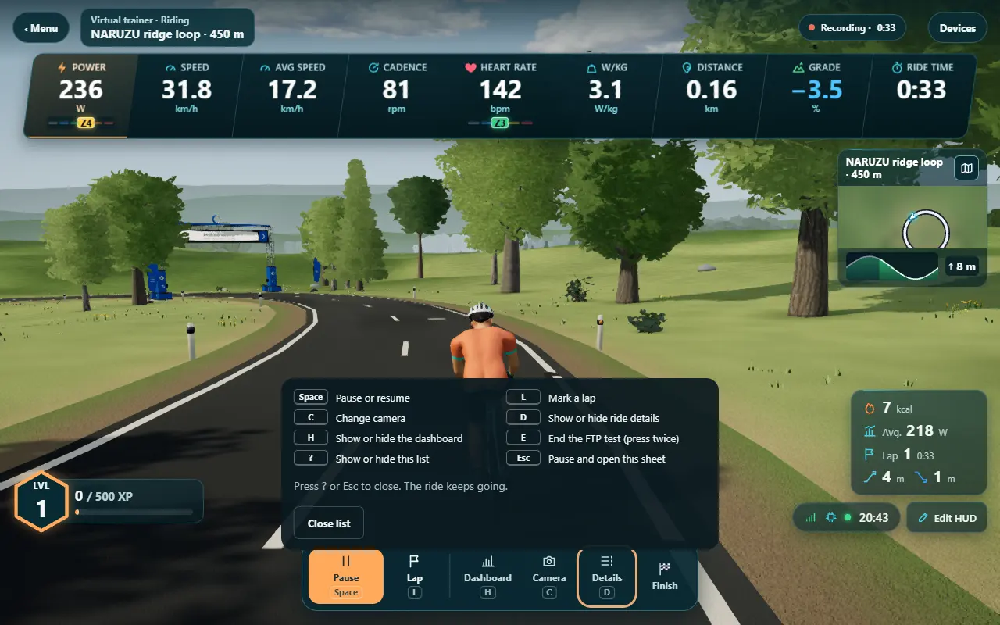

## Ride keys

Press **?** during a ride to see this list on screen. The list is a plain panel: the ride keeps running under it, and **Esc** or **?** closes it.

| Key   | What it does                                                                 |
| ----- | ---------------------------------------------------------------------------- |
| Space | Pause or resume                                                              |
| L     | Mark a lap                                                                   |
| C     | Change camera                                                                |
| D     | Show or hide ride details                                                    |
| H     | Show or hide the dashboard (HUD)                                             |
| E     | End the FTP test (press twice within 3 seconds); does nothing outside a test |
| ?     | Show or hide the shortcuts list                                              |
| Esc   | Pause and open the pause sheet (or close the shortcuts list first)           |

Keys are ignored when you hold Ctrl, Alt or Meta, when a key repeats because you hold it down, when a dialog is open, and while you type in a text field. A focused button takes Space for itself.

## Virtual shifting keys

Only when the ride uses virtual shifting:

| Key                     | What it does |
| ----------------------- | ------------ |
| Arrow Up or Page Up     | Harder gear  |
| Arrow Down or Page Down | Easier gear  |

On a gamepad with standard mapping, the right shoulder button (RB) is harder and the left (LB) is easier. One gear per press.

## Launch screen keys

| Key            | What it does                    |
| -------------- | ------------------------------- |
| Space or Enter | Start the ride once it is ready |
| Esc            | Cancel and keep your setup      |

## Other keys

- **F11** toggles full screen. The Windows app starts in full screen.
- **Photo mode:** drag to look around, scroll or + and - to zoom, arrow keys to turn, **B** to blur the background, **Home** to reset.
- Route maps: arrow keys pan, + and - zoom, Home re-centres. The elevation profile can be explored with the arrow keys.
- The pause sheet lists the shortcuts under "Keyboard shortcuts".

## Accessibility

What the app provides today (checked in the source and automated tests):

- A **Skip to content** link.
- Buttons have text labels and, in the ride bar, announced keyboard shortcuts.
- The ride controls bar can be reached and used with the keyboard; keyboard focus keeps it visible.
- Small "?" help buttons explain terms such as FTP and ERG; they are real buttons that work with keyboard, touch and screen readers.
- **Reduced motion** (Settings, Display and sound) calms the cinematic camera.
- Two themes, **Dark** and **Light**.
- Menus, ride screens, numbers and dates follow your language (English or Czech).
- Sound starts off. Music, ride environment and alerts each have a volume and a mute button.

**Not yet verified:** a full screen-reader walkthrough of every screen, and a colour-contrast audit of the in-ride HUD over every scene.

_Last verified against version 0.1.0-beta.1._
