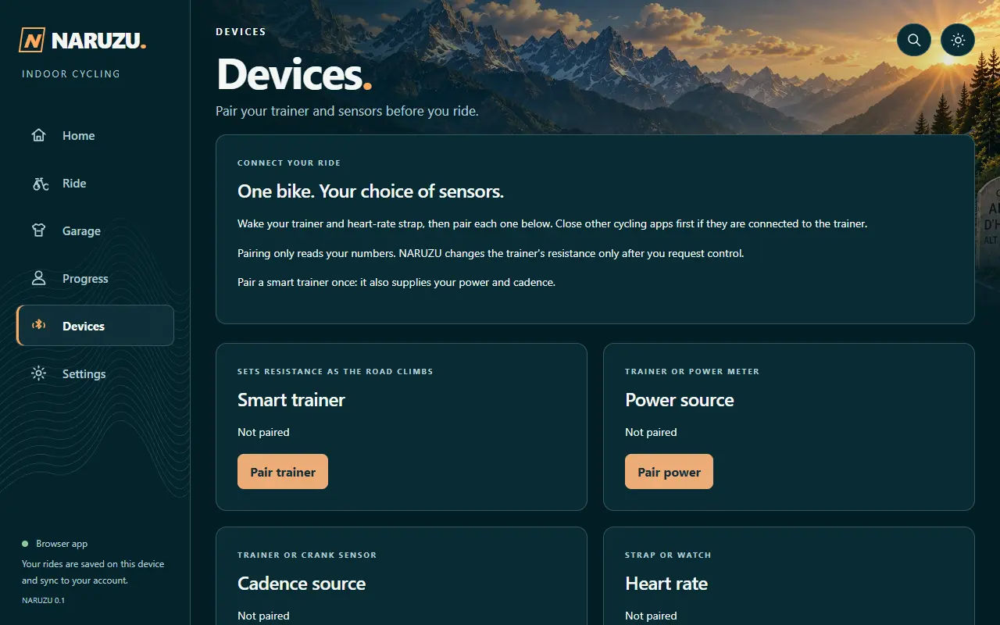
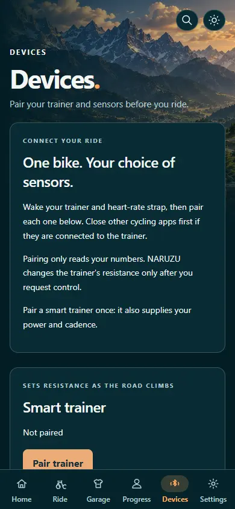

Open **Devices** in the left menu. It has four cards: **Smart trainer**, **Power source**, **Cadence source** and **Heart rate**. Each role is independent, and one physical device can supply several roles.

## Before you start

- Bluetooth needs the **Windows app**, or Chrome or Edge on a secure page (HTTPS or localhost). iPhone Safari cannot pair devices.
- Wake the device: pedal a few turns or press its button.
- Close other cycling apps that may be connected to it. A trainer usually accepts only one controlling app.
- Move close to the device.

## Pair a trainer

1. Choose **Pair trainer**. A chooser lists nearby Bluetooth devices ("Select your trainer or sensor. Scanning updates this list.").
2. Pick your trainer. A smart trainer also supplies power and cadence, so you usually need nothing else.
3. Pairing only **reads** your numbers. NARUZU changes the trainer's resistance only after you **request control**, either with the control check on Devices or when a ride starts with a Bluetooth source.

Cards offer **Change** and **Remove** once paired. Removing the trainer also forgets power and cadence borrowed from it; separate sensors stay.

## Power meter, cadence sensor, heart-rate strap

- **Power source:** a trainer or a separate power meter. Use **Use trainer power** or **Pair power**.
- **Cadence source:** the trainer or a crank sensor.
- **Heart rate:** a strap or a watch that broadcasts heart rate.

There is no automatic fallback between sources: you choose them.

## What works, and what is verified

NARUZU shows controls only for capabilities it detects. The honest status:

| Capability                                                            | Status                                                                                                        |
| --------------------------------------------------------------------- | ------------------------------------------------------------------------------------------------------------- |
| Generic FTMS trainer (telemetry, ERG, grade simulation)               | Software and simulated-device tests pass. **Real trainer response is not yet verified** with this build.      |
| Specific trainer brands                                               | The one trainer that was inspected advertises the standard FTMS service. **No brand is declared compatible.** |
| Heart-rate straps and watches (standard Bluetooth heart-rate service) | Parser tests pass. **Not yet verified** with real straps.                                                     |
| Cycling power and cadence sensors                                     | Standard services are decoded in tests. **Calibration of specific devices not yet verified.**                 |
| ANT+                                                                  | **Not implemented.**                                                                                          |
| Old proprietary trainer protocols                                     | **Not implemented.** NARUZU uses the standard protocol instead.                                               |

If you try your hardware, tell the project what you see; that is how this table improves.

## Control check, ERG and calibration

- **Test trainer control** (on Devices) lets you request control and send a short, light test. The number you send is the trainer's target, not your measured power. Pedal gently with a live power reading first.
- **ERG** needs the trainer to advertise it and a valid power range; targets are clamped to that range.
- **Calibrate trainer** runs a spin-down if the trainer advertises it. You pedal up to a speed shown on screen, then stop and let it coast. Follow the steps shown.
- **Observer mode** reads trainer data without sending any commands; useful when another app controls the trainer.
- If another app holds trainer control, NARUZU asks again every 30 seconds.

## Remembered devices

The Windows app tries your last paired trainer, power, cadence and heart-rate devices at startup. Sleeping devices are retried quietly; no chooser opens and no load is applied. In a browser, only devices you already permitted are reused and a chooser never opens by itself.

## No trainer? Use the virtual trainer

**Try the virtual trainer** makes up power, heart rate and cadence on your computer so you can try a ride without hardware. Choose "Virtual trainer" as the power source in [Setup](/naruzu-web/docs/user/setup-and-launch/). Rides done this way are marked as simulated and cannot set your FTP.

## Phone sensor relay (desktop)

The Devices screen also has a **Phone sensor relay**. It is off until you start it. A phone on the same Wi-Fi can relay sensor readings to the PC over the local network, with a new pairing code each time. The first time it listens, Windows Firewall may ask for permission: allow private networks only. A compatible phone app is needed; the beta's iPhone app is not verified.

## On a narrow window

The Devices screen stacks its cards in one column at 390 pixels wide. This is a narrow browser window, not a verified iPhone.

## Troubleshooting pairing

See [Troubleshooting](/naruzu-web/docs/user/troubleshooting/) for "No device found", dropouts and control problems.

_Last verified against version 0.1.0-beta.1._
