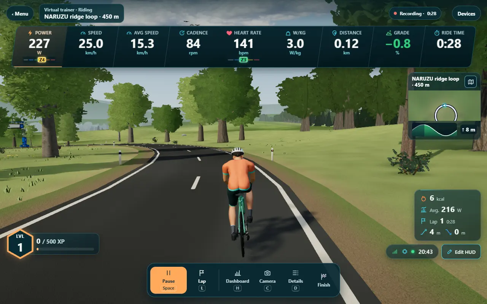
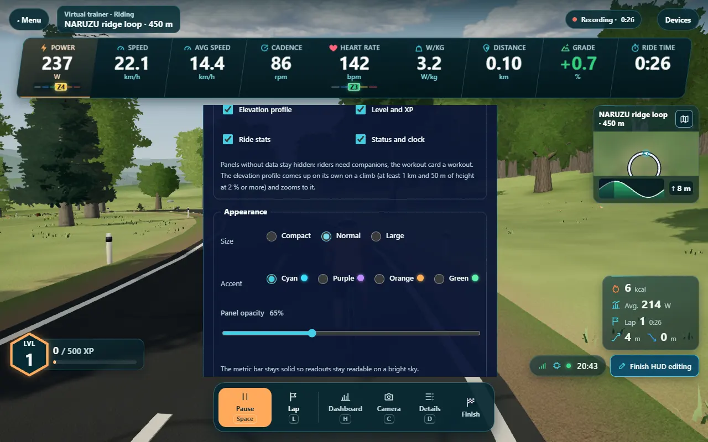
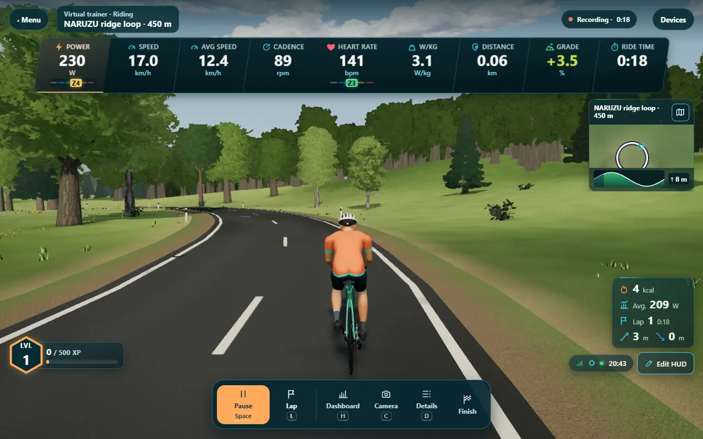
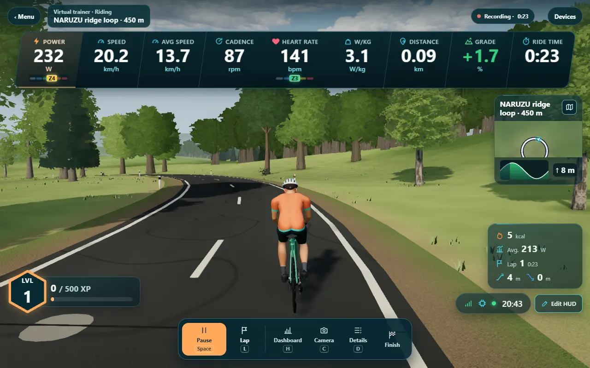
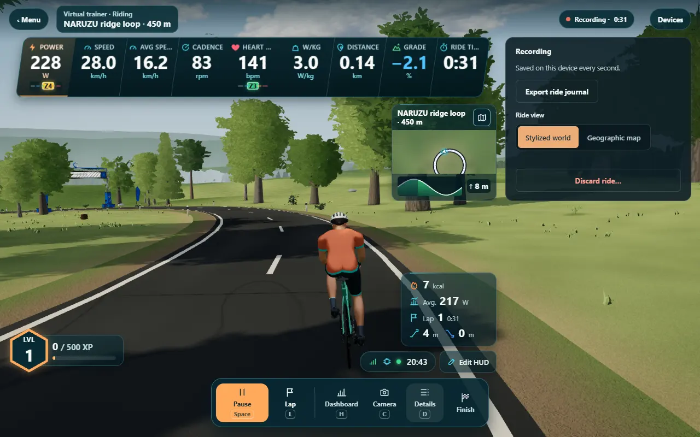

## Top bar: the metrics

The wide bar at the top shows your live numbers. The default set is **Power** (with a zone marker such as Z4), **Speed**, **Average speed**, **Cadence**, **Heart rate** (with its zone), **W/kg**, **Distance**, **Grade** and **Ride time**. Zones use your FTP and your max heart rate.

Missing, stale or contact-lost readings show as unavailable, and a measured zero stays zero. A reading counts as fresh for three seconds.

The bar can show up to 10 metrics chosen from: speed, average speed, power, 3 s power, 30 s power, average power, normalized power, heart rate, cadence, W/kg, distance, ride time, elapsed time, moving time, grade, climbed, descended, lap time, W-prime balance, energy and gear.

How some are calculated: normalized power needs 30 continuous active seconds and stays provisional below five minutes or with gaps. W-prime balance shows a dash until you set your own critical power and W-prime in the HUD settings; it is a simple estimate and your FTP is not used as critical power. Energy (kcal) is estimated from your work.

## Other panels

- **Minimap** with your position and the route's elevation profile. An elevation profile comes up on its own on a climb (at least 1 km and 50 m of height at 2 percent or more).
- **Ride stats:** energy, average power, lap, height climbed and descended.
- **Level and XP** badge.
- **Status and clock:** how many sensors are connected, whether the ride is being saved ("Saved on this device every second"), and the time.
- **Current workout** card (only on a workout ride) and **Nearby riders** (only with companions, which are not in the public beta).

Panels without data stay hidden.

## Change the HUD

Choose **Edit HUD** (bottom right) to open the HUD settings. You can:

- Pick a **preset**: Race, Minimal or Workout. **Reset HUD** returns to the preset.
- Add, remove and reorder top bar metrics.
- Show or hide panels.
- Set the **HUD size** (density): **Compact**, **Normal** or **Large**; an accent colour (Cyan, Purple, Orange, Green); and panel opacity (50 to 95 percent). The metric bar always stays solid so numbers stay readable on a bright sky.
- Configure critical power and W-prime.

On a phone, Compact shows only the first four top-bar metrics, and the phone keeps its own saved layout, separate from the wide screen layout.

| Compact                                         | Large                                       |
| ----------------------------------------------- | ------------------------------------------- |
|  |  |

## The controls bar

The bar at the bottom has these buttons. The key is shown on the button where a keyboard is available.

| Button         | What it does                                          | Key   |
| -------------- | ----------------------------------------------------- | ----- |
| Pause / Resume | Pause or resume the ride                              | Space |
| Lap            | Mark a lap (recorded in the ride and in the FIT file) | L     |
| Dashboard      | Show or hide the HUD                                  | H     |
| Camera         | Change camera (stylized world only)                   | C     |
| Details        | Open the ride details drawer                          | D     |
| Finish         | Ask to finish the ride                                | none  |

If you are using virtual shifting, easier and harder gear buttons also appear in the bar.

The bar fades away after about six seconds of quiet while you ride. Moving the pointer, touching the screen or pressing a key brings it back, and so does a **Show ride controls** button. It stays while you hover it or use it with the keyboard.

The **Details** drawer shows the workout controls (if any), the recording status with **Export ride journal**, the **Ride view** switch (Stylized world or Geographic map) and **Discard ride...**.

## Camera

The camera key cycles the view: behind the rider, side, first person, cinematic. You can also pick a default under Settings, Display and sound. With **Reduced motion** on, the cinematic camera stays behind the rider.

Full key list: [Keyboard shortcuts and accessibility](/naruzu-web/docs/user/keyboard-and-accessibility/).

_Last verified against version 0.1.0-beta.1._
