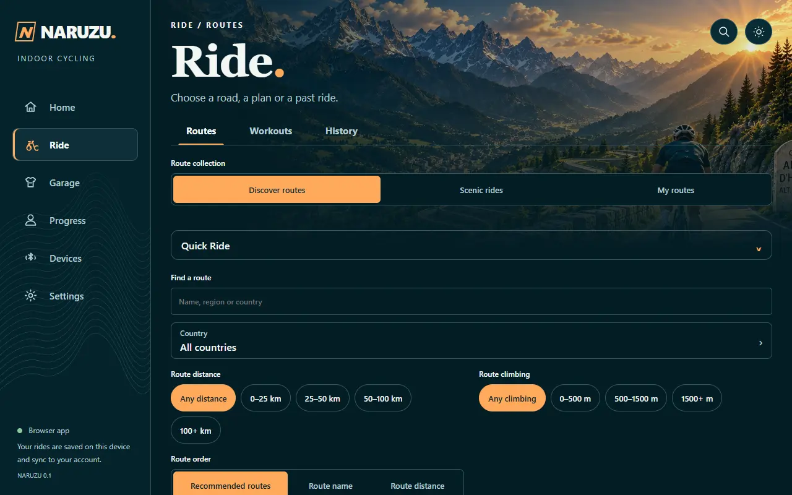
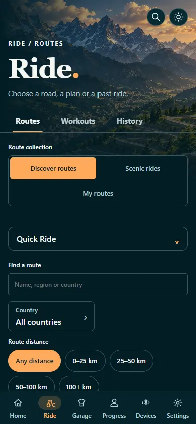
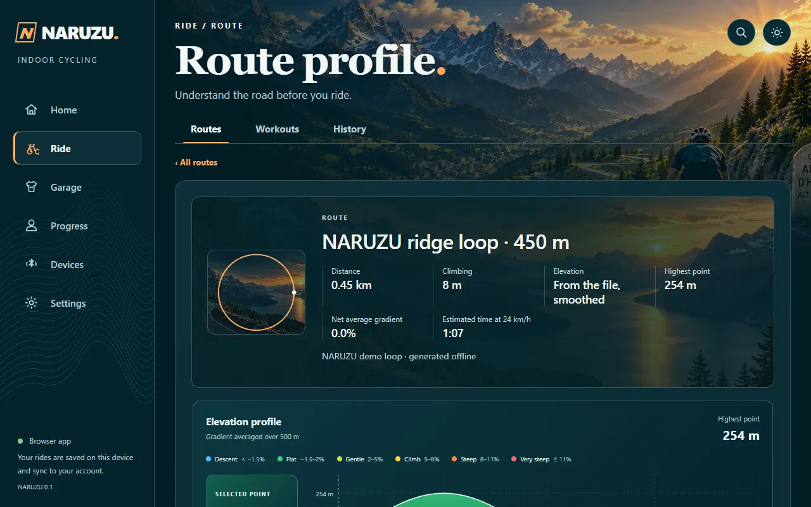

Open **Ride**, then the **Routes** tab. A **Route collection** switch has three views: **Discover routes**, **Scenic rides** and **My routes**.

On a narrow window (390 pixels) the filters stack in one column:

## Discover routes

Discover routes lists the built-in roads. At the time of writing the list showed 120 routes in the beta build. You can:

- Search by name, region or country ("Find a route").
- Filter by **Country**, **Route distance** (0 to 25 km up to 100+ km) and **Route climbing** (0 to 500 m up to 1500+ m).
- Order by recommended, name, distance or climbing.

Each card shows the distance, climbing, average grade and, for big climbs, a category badge. Choose a card to open its detail page with a gradient-coloured profile, then **Ride this route** to go to [Setup](/naruzu-web/docs/user/setup-and-launch/).

The **Demo loop** is a short, fictional, generated loop (0.45 km) that needs no download. It is the quickest way to try riding.

## Scenic rides

Scenic rides are curated roads with artwork. Their scenery is drawn around the road; it is not a copy of the real place. Wind and weather are for looks only and never change trainer resistance or your speed.

## Quick Ride

**Quick Ride** (at the top of Routes) finds a random real-road loop for you. You set what you want, and NARUZU chooses a road.

1. Optionally enter a **starting place** (a town, region or country), or leave it blank to search anywhere in the world.
2. Set the distance and climbing ranges. The actual distance and climbing must fit them. Choose **Road** or **Mixed surfaces**; surface is a preference based on available map data.
3. Choose how many **search attempts** (up to 100, 250 or 1,000). It stops at the first match. Larger searches can take minutes or longer; you can cancel at any time.
4. Choose **Find a ride**. You can **Try another**, **Export GPX**, or **Ride this**, which saves the GPX and prepares real terrain and mapped scenery before opening Setup.

Good to know:

- New route searches **need the internet** and use public map services (Photon and BRouter). Saved, prepared routes work offline.
- The map services can be busy; the app then says so and suggests trying again later or using the built-in router.
- A "Fictional generated loop" option makes a made-up loop with an optional **seed**, so you can ride the same loop again.
- Very long routes and dense cities can load slowly or have plain scenery. See [Performance and known issues](/naruzu-web/docs/user/performance-and-known-issues/).

## Import your own GPX (or FIT)

On the Routes tab choose **Import GPX**, or open **My routes**. Then:

1. Pick or drop a `.gpx` or `.fit` file, up to 10 MB. A FIT file needs a continuous GPS section; indoor files without GPS cannot supply a route.
2. Give the course a name. Under **Details** you can add a country and a source attribution.
3. If the file has several sections, choose one **Continuous section**.
4. Check the preview (distance, climbing, points), then choose **Save previewed route**.

If a file has no elevation data it is ridden as **flat terrain** (the "flat fallback"), so climbs and descents are not felt. Preparing real terrain in Setup can add real elevation.

**Edit in My routes** lets you manage your own routes, and **Export GPX** saves a route as a file.

## Offline

Saved and prepared routes work without internet. See [Offline use](/naruzu-web/docs/user/offline-use/).

_Last verified against version 0.1.0-beta.1._
