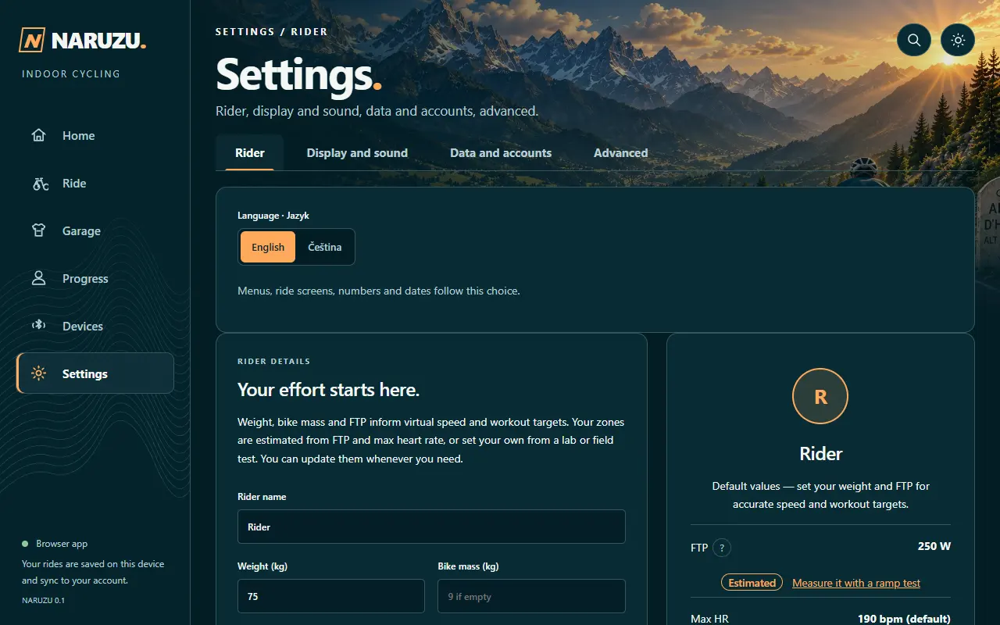
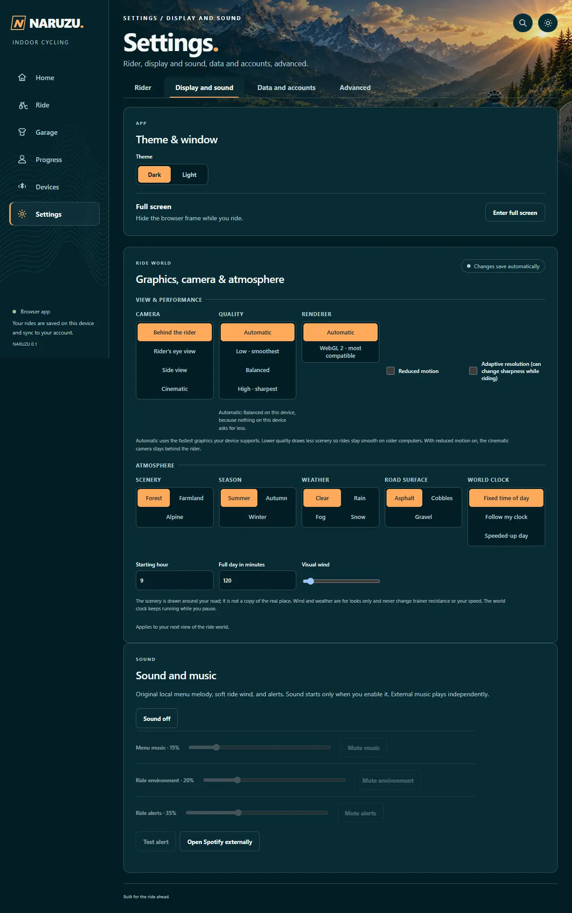
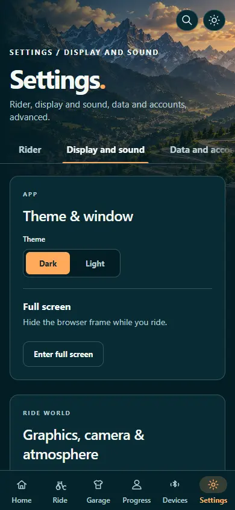
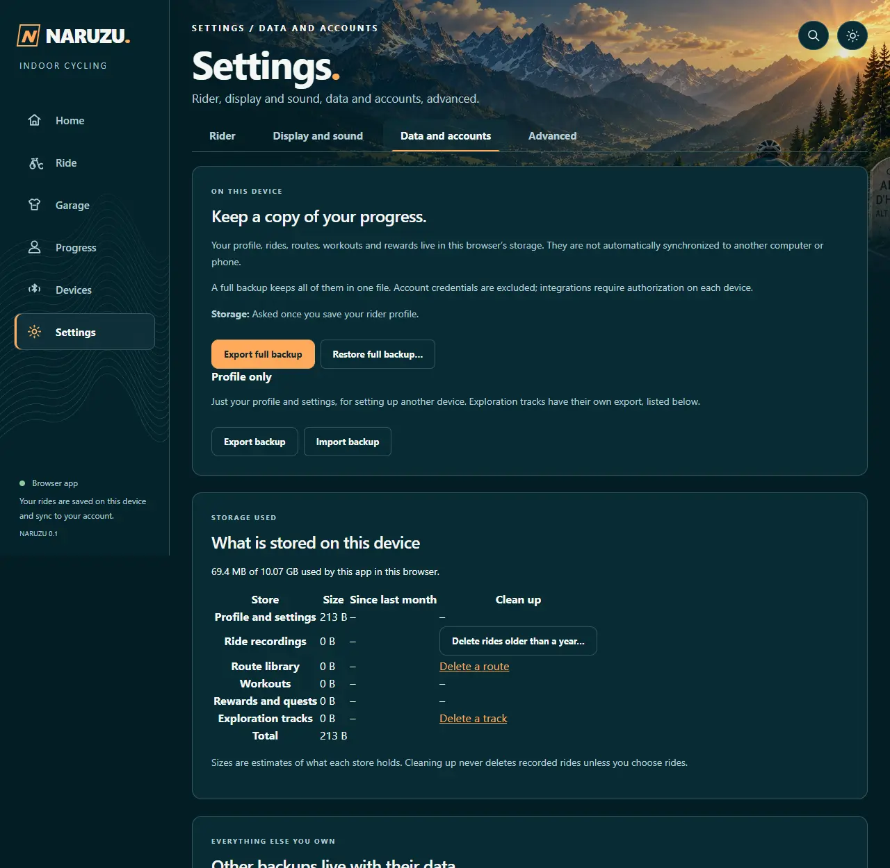
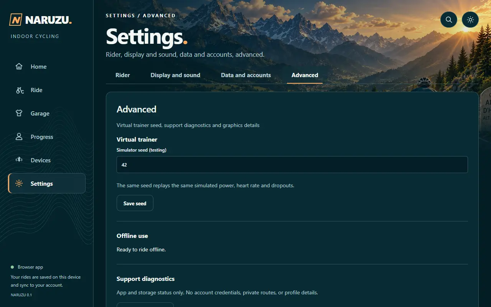

Settings has four tabs: **Rider**, **Display and sound**, **Data and accounts** and **Advanced**.

## Rider

- **Language:** English or Čeština. Menus, ride screens, numbers and dates follow it.
- **Rider name, Weight, Bike mass, FTP, Max heart rate.** Weight, bike mass and FTP inform virtual speed and workout targets. If bike mass is empty a default (9 kg shown as a hint) is used. FTP outside the accepted range is corrected and the app tells you.
- **Display units:** **Metric** (kg, km) is the default; **Imperial** (lb, mi) is optional.
- **Power zones** and **Heart-rate zones** are estimated from FTP and max heart rate, or you can enter your own.
- **Save rider profile** saves it on this device.

## Display and sound

- **Theme:** Dark or Light. **Full screen** (F11).
- **Camera:** behind the rider, rider's eye view, side view or cinematic.
- **Quality:** Automatic (default), Low smoothest, Balanced, High sharpest. Automatic picks the fastest graphics your device supports; lower quality draws less scenery so rides stay smooth on older computers.
- **Renderer:** Automatic or WebGL 2, the most compatible.
- **Reduced motion** and **Adaptive resolution** (may change sharpness while riding).
- **Atmosphere:** scenery (forest, farmland, alpine), season, weather, road surface and a world clock (fixed time of day, follow my clock, or speeded-up day). Wind and weather are for looks only and never change trainer resistance or speed.
- **Sound:** off by default; "Sound starts only when you enable it". Separate volume and mute for menu music, ride environment and ride alerts, and a **Test alert** button. **Open Spotify externally** opens Spotify outside NARUZU; it plays independently and refusing it never prevents a ride.

Changes save automatically and apply to your next view of the ride world.

## Data and accounts

- **Backups.** **Export full backup** keeps your profile, rides, routes, workouts and rewards in one file (up to 400 MB). **Restore full backup** replaces this device's data after keeping a copy of everything first. Account credentials are never included. **Profile only** exports just profile and settings.
- **Storage used** shows what takes space and offers cleanup such as deleting rides older than a year. Cleanup never deletes rides unless you choose rides.
- **Connections and uploads:** optional Intervals.icu and Strava links and an upload outbox; see [Pause, finish and export](/naruzu-web/docs/user/finish-and-export/).
- **Offline maps** (desktop app) and **About this copy**, see [Offline use](/naruzu-web/docs/user/offline-use/).
- **Your data and who can see it:** see [Privacy and your data](/naruzu-web/docs/user/privacy-and-data/).

## Advanced

- **Virtual trainer, Simulator seed:** the same seed replays the same simulated power, heart rate and dropouts (mainly for testing).
- **Offline use** status.
- **Export diagnostics** saves a small JSON file with app and storage status, what your machine supports and a short event log. It leaves out credentials, private routes and profile details, and is never uploaded: you send it yourself. Look inside before you share it.
- **Graphics diagnostics:** ride once to measure the ride world on this device. Frame times describe the last ride on this device only.

_Last verified against version 0.1.0-beta.1._
