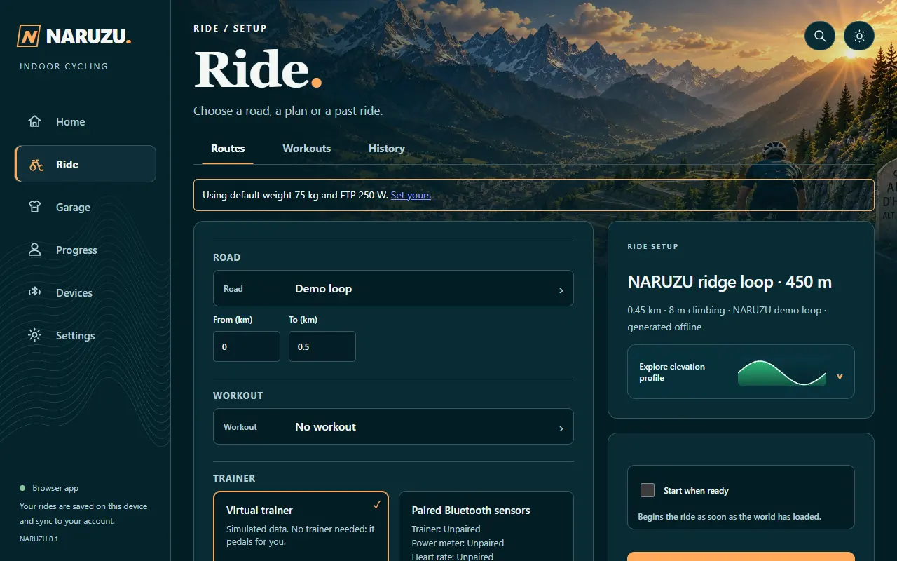
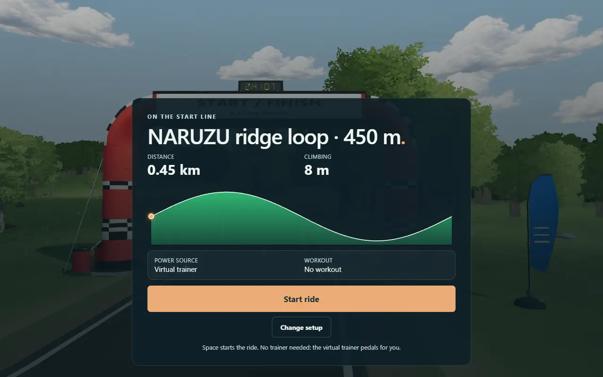

Every ride goes through one **Setup** screen. Open it from a route's **Ride this route** button (see [Routes and Quick Ride](/naruzu-web/docs/user/routes-and-quick-ride/)) or from a workout.

## The rows

- **Road.** Shows the chosen road. Pick another with the Road row. **From (km)** and **To (km)** let you ride only a stretch of it.
- **Workout.** "No workout" is a free ride at your own pace. Choose a workout to ride its steps; the road repeats until the workout ends and targets use your FTP at the moment you start.
- **Trainer.** Either **Virtual trainer** ("Simulated data. No trainer needed: it pedals for you."; pick it and a **Simulator seed** appears, the same seed replays the same simulated power, heart rate and dropouts) or **Paired Bluetooth sensors**, which lists your trainer, power meter, heart rate and cadence. If a Bluetooth ride needs something (a fresh power source, or an ERG-capable trainer with control requested), Setup tells you and links to Devices. If trainer control is switched off, Setup warns that an ERG workout cannot start and offers **Turn trainer control on**.
- **Repeat last ride.** Reloads the previous road and workout. A deleted road keeps your current setup and shows a message; an edited workout rides as it is now, and a deleted one is left out with a message.

If you never set your weight and FTP, a banner says "Using default weight 75 kg and FTP 250 W. Set yours". See [Ramp test and FTP](/naruzu-web/docs/user/ramp-test-and-ftp/).

## Advanced

The **Advanced** button opens groups of less common choices:

- **Scenery and view.** Prepare real-world scenery and terrain for a route, and choose the **Ride view**: _Stylized world_ or _Geographic map_. Real elevation needs a one-time online download unless it is already saved; prepared scenery and terrain work offline.
- **Trainer and road.** Choices about how the trainer follows the road, including trainer difficulty for climbs, descent damping, riding a section as flat terrain, and **Virtual shifting (Experimental)**, which shifts gears on the trainer without changing your real gear (offered only when the trainer advertises simulation control).
- **Companions and ghosts.** Not described in this guide for the public beta.

For a workout on a Bluetooth ride you also get a checkbox to use the trainer's ERG control (see [Workouts and ERG](/naruzu-web/docs/user/workouts-and-erg/)).

## Load ride, Start when ready

- **Load ride** loads the world and then **waits on the start line for you**.
- Tick **Start when ready** to begin the ride automatically as soon as the world has loaded (the button then reads "Load and ride").

## What the launch screen does

After you choose Load ride, a launch screen works through the steps Road, Terrain and map, Graphics and World. When it is ready you see "On the start line" with the distance, climbing and profile of your road, your power source and workout, and a **Start ride** button. **Space** or **Enter** starts the ride; **Esc** cancels and keeps your setup. **Change setup** goes back.

If scenery cannot be loaded you can still ride: metrics, workout and recording work without scenery (**Ride without scenery**). Other options after a failed launch include **Try again**, **Use simpler graphics**, and switching between the stylized world and the geographic map.

### How long does loading take? An honest answer

Launching compiles graphics programs, and that takes time. These are measurements the project made on one development laptop (integrated AMD Radeon 890M graphics, a production build in a browser, with other programs using the machine):

| Route                  | From Load ride until Start is offered |
| ---------------------- | ------------------------------------- |
| Short Demo loop        | about 20 to 22 seconds                |
| A heavy mountain route | about 46 to 78 seconds                |

The app says the same in its own words: "First load of this route on this device: it can take a minute. Later rides start faster." These numbers come from one machine and only a few runs. **Other graphics cards, the installed desktop app and second launches were not measured.** Your time may be shorter or longer.

## Pause menu and photo mode

Both are covered in [Pause, finish and export](/naruzu-web/docs/user/finish-and-export/).

_Last verified against version 0.1.0-beta.1._
